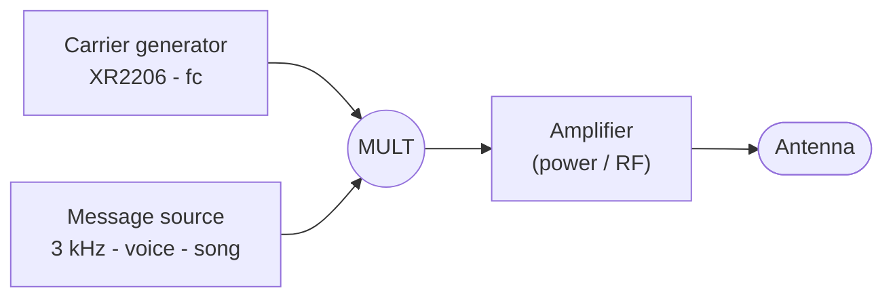
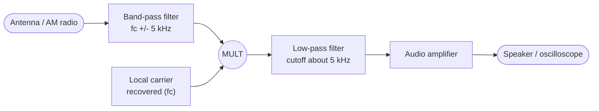
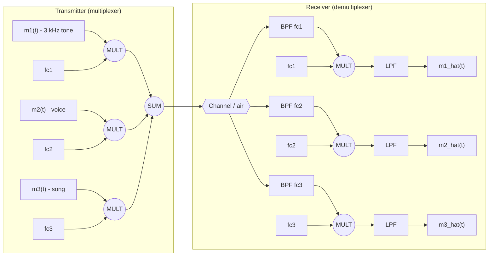

# Analog Multiplier - Amplitude Modulation (AM)

> **Linear Systems** course project: MATLAB simulation and physical build of an AM
> modulator/demodulator using an analog multiplier, with frequency-division
> multiplexing (FDM) of three signals.

**Status:** in progress - see [Roadmap](#11-roadmap).

---

## 1. Objective

Verify the **modulation property** of the Fourier Transform experimentally: multiplying
two signals in time **shifts** the spectrum in frequency. To do so I both simulate and
build an analog multiplier that:

1. Modulates a 3 kHz tone, a voice recording and a song segment in the commercial AM
   band.
2. Multiplexes and demultiplexes three AM signals (FDM).
3. Recovers the information with a coherent demodulator (multiplier) followed by a
   low-pass filter.
4. Is verified over the air with an AM radio receiver.

The simulated result must **match** the physical circuit.

## 2. Theory

### 2.1 Modulation property

If $m(t) \leftrightarrow M(f)$ and the carrier is $c(t) = A_c \cos(2\pi f_c t)$, then

$$
s(t) = m(t)\,c(t) \;=\; m(t)A_c\cos(2\pi f_c t)
\;\longleftrightarrow\;
S(f) = \frac{A_c}{2}\Big[M(f-f_c) + M(f+f_c)\Big]
$$

An ideal multiplier transmits **no carrier** (DSB-SC, *Double Side Band Suppressed
Carrier*): the message spectrum is replicated at $f_c \pm B$. The time-domain product is
implemented in hardware with a **Gilbert cell** (LM1496).

### 2.2 AM with carrier and modulation index

A real multiplier has DC offset and carrier feedthrough. Modelling that offset as a DC
term $A_0$ on the message input:

$$
s(t) = \big[A_0 + m(t)\big]A_c\cos(2\pi f_c t)
$$

For $m(t) = A_m\cos(2\pi f_m t)$ the spectrum has three lines: $f_c$ (carrier) and
$f_c \pm f_m$ (sidebands). The **modulation index** is

$$
\mu = \frac{A_m}{A_0}, \qquad
\mu = \frac{A_{\max} - A_{\min}}{A_{\max} + A_{\min}}
$$

The second form is **read directly off the Lissajous / trapezoid figure**, where
$A_{\max}$ and $A_{\min}$ are the maximum and minimum envelope amplitudes.

- $\mu = 0$: no information (carrier only).
- $0 < \mu \le 1$: proper AM. At $\mu = 1$ the envelope reaches zero.
- $\mu > 1$: **overmodulation** - phase reversal and distortion in an envelope detector.

### 2.3 Coherent demodulation

Multiplying the received signal by a local carrier $2\cos(2\pi f_c t)$ and low-pass
filtering gives

$$
2\,s(t)\cos(2\pi f_c t) = A_0A_c + A_c\,m(t) + \underbrace{A_c\big[A_0 + m(t)\big]\cos(4\pi f_c t)}_{\text{removed by the LPF}}
$$

The result carries a DC term ($A_0A_c$) that must be removed (DC block or high-pass).
In short: **multiply + low-pass filter = shift the spectrum back to baseband**. The
local carrier must be synchronized in frequency and phase (carrier recovery); a phase
error $\phi$ attenuates the output by $\cos\phi$.

### 2.4 Frequency-division multiplexing (FDM)

$$
s_{\text{FDM}}(t) = \sum_{i=1}^{3} s_i(t), \qquad
s_i(t) = m_i(t)A_c\cos(2\pi f_{c,i} t)
$$

To separate them at the receiver: **band-pass filter** around $f_{c,i}$, multiply by the
local carrier $f_{c,i}$, then **low-pass filter** (Figures 2 and 3 of the assignment).
Channel spacing must exceed $2B$, where $B$ is the message bandwidth.

## 3. System architecture

### 3.1 Transmitter (Part B)



### 3.2 Receiver (Parts B and D)



### 3.3 Full system with multiplexer/demultiplexer (Part C)



## 4. Repository layout

```
analog-multiplier/
├── main.m            # Full simulation (assignment sections A-E)
├── audio/            # Input signals (not versioned when copyrighted)
│   ├── voice.wav
│   └── song.wav
├── figs/             # Figures exported by main.m (for the report)
├── docs/             # Diagrams, design notes, channel selection worksheet
├── LICENSE           # MIT
└── README.md
```

## 5. Requirements

- **MATLAB R2020a or newer** (`audioread`, `resample`, `bandpass`, `exportgraphics`).
- No toolbox is required: the multiplier is a plain element-wise product, which is the
  whole point of the project.
- *Optional:* Communications Toolbox (`ammod`/`amdemod`) only as a **cross-check**, never
  as a replacement for the multiplier.
- For the build: 2x LM1496 (modulator and demodulator), XR2206 (carrier), audio
  amplifier, RC/active filters, AM radio receiver, oscilloscope, function generator,
  +/-12 V supply.

## 6. How to run

```matlab
>> cd analog-multiplier
>> main          % runs the whole flow and saves figures into figs/
```

The flow is controlled from inside `main.m`:

## 7. Design parameters

| Symbol | Value | Rationale |
| ------ | ----- | --------- |
| $f_m$ (tone) | 3 kHz | Required by the assignment |
| $B$ (audio) | 5 kHz | AM channels are 10 kHz apart, so usable audio is at most 5 kHz |
| $f_c$ | 3 AM channels, 535-1705 kHz | Mexican AM broadcast band, 10 kHz channel spacing (IFT-001-2015); must be **free** channels in Mexico City |
| $f_s$ | at least 2.5 MHz | Nyquist: $f_s > 2(f_c^{\max} + B)$; margin left for the filter |
| $T$ | 1 s (tone) / 5-10 s (voice, song) | Enough to show envelope and spectrum |
| $A_c$ | 1 V (simulation scale) | Normalization; the real amplitude is set by the LM1496 |
| $A_0$ | $A_m/\mu$ | Sets the modulation index; $A_0 = 0$ gives DSB-SC |
| $\mu$ | 0.5 nominal, swept 0.1-1.5 | To show the effect of the modulation index |
| $f_{\text{cutoff,LPF}}$ | 5 kHz | Recovers the message and rejects $2f_c$ |

### 7.1 Selected AM channels (Part A) - to be defined

The list of AM stations in here (CDMX) must be consulted and three **empty** frequencies
at least 10 kHz apart must be chosen (ideally 20 kHz or more apart, so the receiver
band-pass filters fit).

| Channel | $f_c$ | Occupancy checked (date/source) | Status |
| ------- | ----- | ------------------------------- | ------ |
| 1 | _TBD_ | | open |
| 2 | _TBD_ | | open |
| 3 | _TBD_ | | open |

## 8. Mapping to the assignment (sections A-E)

| Section | Deliverable | Where it lives |
| ------- | ----------- | -------------- |
| **A** | 3 free AM channels in Mexico City | Section 7.1 of this README + `docs/` |
| **B** | AM modulator, simulated and built (tone, then voice, then song); TX + RX; low-pass filter and amplifier | `main.m` sections 1-7, cases `tone`/`voice`/`song` |
| **C** | Multiplexer/demultiplexer of three AM signals | `main.m` section 8 |
| **D** | Demodulator built around a multiplier, tested with voice and song | `main.m` sections 6-7 + prototype |
| **E** | Block diagrams, justification of frequencies and amplitudes, explanation of every MATLAB command, numbered figures, Lissajous, modulation index, individual conclusions | `docs/` + report |

## 9. From the simulator to the prototype

Every simulation block maps to a physical block; comparing simulation against measurement
is part of the evaluation.

| Block | In `main.m` | In the circuit |
| ----- | ----------- | -------------- |
| Carrier | `Ac*cos(2*pi*fc*t)` | XR2206 oscillator ("Oscillator circuit" figure) |
| Multiplier | `m .* c` | LM1496P (Gilbert cell), differential input |
| DC offset / $\mu$ | constant `A0` added to `m(t)` | Bias on the message input (R1/R2 + potentiometer) |
| RX band-pass filter | `bandpass(..., [fc-B fc+B], fs)` | LC tank / tuned ceramic filter |
| Local carrier | `cos(2*pi*fc*t)` | LM1496 in synchronous detector mode, or envelope detector when the carrier is present |
| Low-pass filter | `butter` + `filtfilt` | 5 kHz RC/active filter |
| Amplifier | `gain * y` | LM386 / power stage plus an RF amplifier at the TX |

**Note:** the LM1496 delivers the difference of the differential-pair currents, so in
practice there is carrier feedthrough rather than a perfect DSB-SC signal. That residual
is exactly what is measured as $A_0$ and what the modulation index is computed from. The
non-idealities of real multipliers (offset, distortion, bandwidth, imbalance) are
mandatory material for the conclusions.

## 10. Figures to deliver

`main.m` exports every figure into `figs/` with fixed numbering.

- [ ] `fig01` - Block diagram of the transmitter and the receiver
- [ ] `fig02` - Block diagram including the multiplexer/demultiplexer
- [ ] `fig03` - Message $m(t)$: time and spectrum
- [ ] `fig04` - Carrier $c(t)$: time and spectrum
- [ ] `fig05` - **Modulator input** (time and frequency)
- [ ] `fig06` - **Modulator output** (time and frequency) with $f_c \pm f_m$ marked
- [ ] `fig07` - Modulation index on the envelope ($A_{\max}$, $A_{\min}$, $\mu$)
- [ ] `fig08` - **Lissajous figure** $m(t)$ vs $s(t)$ (trapezoid) and the $\mu$ reading
- [ ] `fig09` - Demodulator input and output (time and spectrum)
- [ ] `fig10` - Low-pass filter output vs the original message (error / correlation)
- [ ] `fig11` - Multiplexing: FDM channel spectrum and recovery of the three signals
- [ ] `fig12` - _(optional)_ Circuit photos, oscilloscope measurements and radio reception

## 11. Roadmap

| # | Task | Status |
| - | ---- | ------ |
| 1 | Repository, license, README | done |
| 2 | Select three free AM channels | pending |
| 3 | 3 kHz tone modulation with time/frequency figures | pending |
| 4 | Voice and song modulation (resampling to the simulation $f_s$) | pending |
| 5 | Modulation index and Lissajous figure | pending |
| 6 | Coherent demodulator plus low-pass filter | pending |
| 7 | Three-signal multiplexer/demultiplexer | pending |
| 8 | Physical build (LM1496 + XR2206) and measurements | pending |
| 9 | Simulation vs measurement comparison and AM radio transmission | pending |
| 10 | Final report (conclusions written **individually**) | pending |

## 12. License

Released under the **MIT** license - see [LICENSE](LICENSE).

Audio files in `audio/` are **not** versioned due to copyright: you must drop your own files (`voice.wav`, `song.wav`) into that folder.
